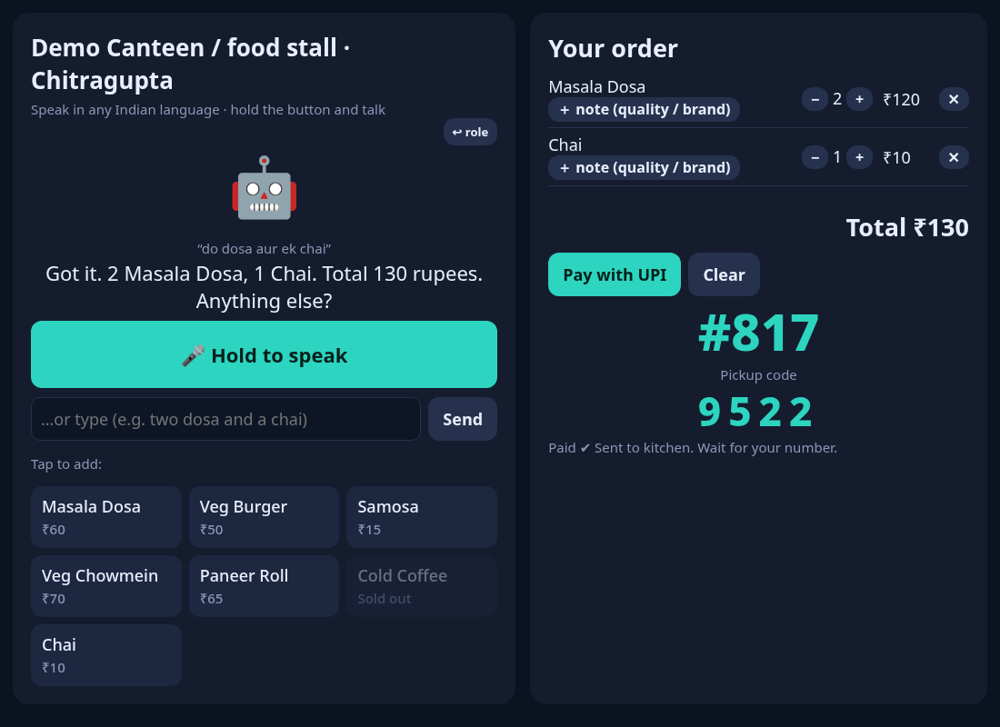
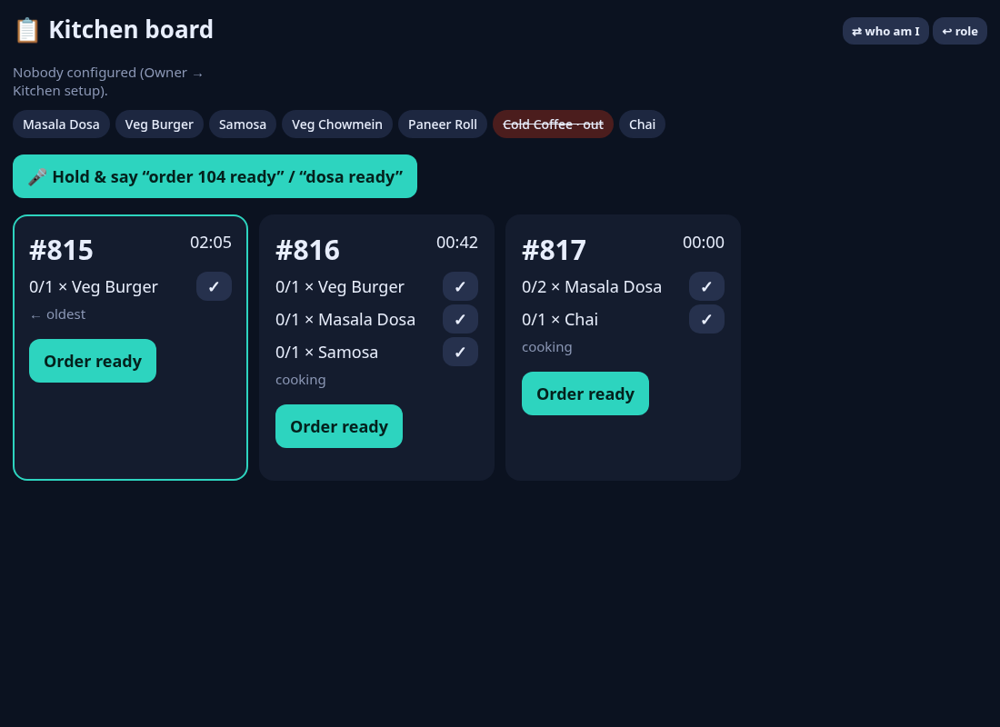
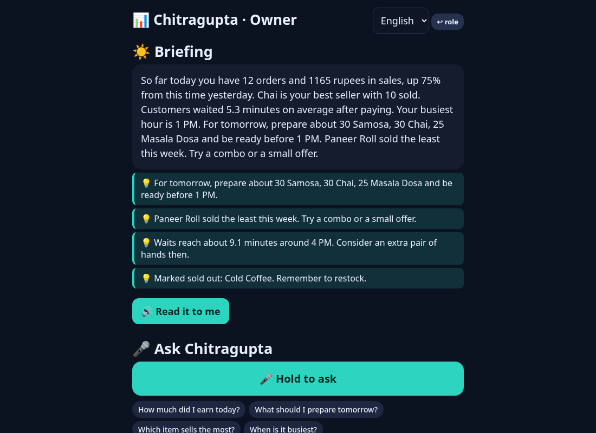

# Chitragupta

**A voice-first AI business partner for small shops, in the owner's own language.**
Say the order in Hindi, Telugu, English or a mix. Get a priced cart, a kitchen that speaks, and a copilot that knows your sales.

Built for PromptWars x DevSphere Hacks on **Google Gemini** and **Firestore**.

## The problem
A small shop is run by one overloaded owner with paper slips, memory and WhatsApp. Orders are slow and wrong in the rush,
payments are not tied to orders, nobody tells the owner what is selling, and the software that exists is English-only and built for chains.

## What it does
| | |
|---|---|
| **Voice and text ordering** | Speak or type an order ("do dosa aur ek chai, no sugar"). Gemini maps it to the shop's menu; **prices always come from the catalog, never from the model**. |
| **Kitchen that talks** | Each cook gets one task at a time on their own phone, spoken in their language. "Order N is ready" is announced at the counter. |
| **Payments tied to orders** | UPI QR per order (demo adapter). An order reaches the kitchen only after payment is confirmed server-side. |
| **Pickup codes** | Every order gets a 4-digit code; the counter checks it before handing over. |
| **Owner copilot** | Daily briefing, "ask anything" about sales and stock, restock advice, grounded only in real order data. |
| **Many shops, one backend** | Shops sign up, get a shop code and pair counter / kitchen / owner phones. Data is isolated per shop. |

## Screenshots
| Counter | Kitchen board | Owner copilot |
|---|---|---|
|  |  |  |

## Get the apps
- **Web app:** open the deployed link (added after deployment). It works on a phone browser too.
- **Android app:** download the APK from the [latest release](https://github.com/VishalGopu/chitragupta/releases/latest). It is a native Kotlin/Compose app that talks to the same backend. The APK is hosted as a release asset, not committed, to keep the repository small.

## Google services
| Service | Role |
|---|---|
| **Gemini API** (`gemini-3.5-flash`) | Order parsing, owner copilot, and speech-to-text (audio in, English text and language out) |
| **Gemini text-to-speech** (`gemini-3.1-flash-tts-preview`) | Spoken replies, briefings and kitchen tasks |
| **Cloud Firestore** | Shop registry and per-shop state (orders, catalog, stock, kitchen) |

## Architecture
```
 Counter phone      Kitchen phone      Owner phone       Android app
 mic / type / QR    spoken tasks       briefing / ask    (native, same API)
        \               |                /                   /
   Next.js + React front end (TypeScript, static export)       |
        \_______________ served by ______________________/
         Node backend: REST API + SSE live updates (no framework)
              |                 |                  |
        Gemini parser     Gemini STT / TTS     Firestore
        (rules fallback)  (browser voice fallback)  (file store for tests)
```
One container serves both: the Dockerfile builds the Next.js app to static files, and the Node server serves them next to `/api`.

### Repository layout
| Path | What |
|---|---|
| `web/` | Next.js (App Router) + React + TypeScript front end; `lib/` API client, voice and hooks; `components/` one per screen |
| `src/` | Node backend: order engine, Gemini client, Firestore store, multi-shop auth, rate limiting |
| `profiles/` | Shop types (canteen, tiffin, restaurant, kirana) |
| `test/`, `web/test/` | Backend (Node test runner) and front-end (Vitest + Testing Library) tests |
Every model call has a timeout, a per-shop daily quota and a concurrency gate. If Gemini is unreachable the order parser falls back
to an offline rules parser, so the counter never stops working.

## Run it
```bash
npm install
cp .env.example .env     # add GEMINI_API_KEY (and set STORE=firestore + credentials to use Firestore)
npm run build            # builds the Next.js front end to web/out
npm start                # http://localhost:8080  (single shop)
TENANCY=multi npm start  # multi-shop mode with signup, shop codes and a one-tap demo shop
```
For front-end work, run `npm run dev:web` (hot reload on :3000) beside the backend. No Gemini key? Typed input, the rules parser and the browser's own voice still work.

## Tests
- `npm test`: backend, including an end-to-end test that boots the real server (order flow, kitchen scheduling, insights, shop types, multi-shop isolation, security headers, rate limits, Gemini client with mocked HTTP).
- `npm run test:web`: front end (units, WAV encoding, role gating, landing and counter flows).
- `npm run test:coverage`: backend coverage.
CI runs both, plus the TypeScript check and a production build, on every push.

## Docs
See [docs/EVALUATION.md](docs/EVALUATION.md) for the plan and checklist.
